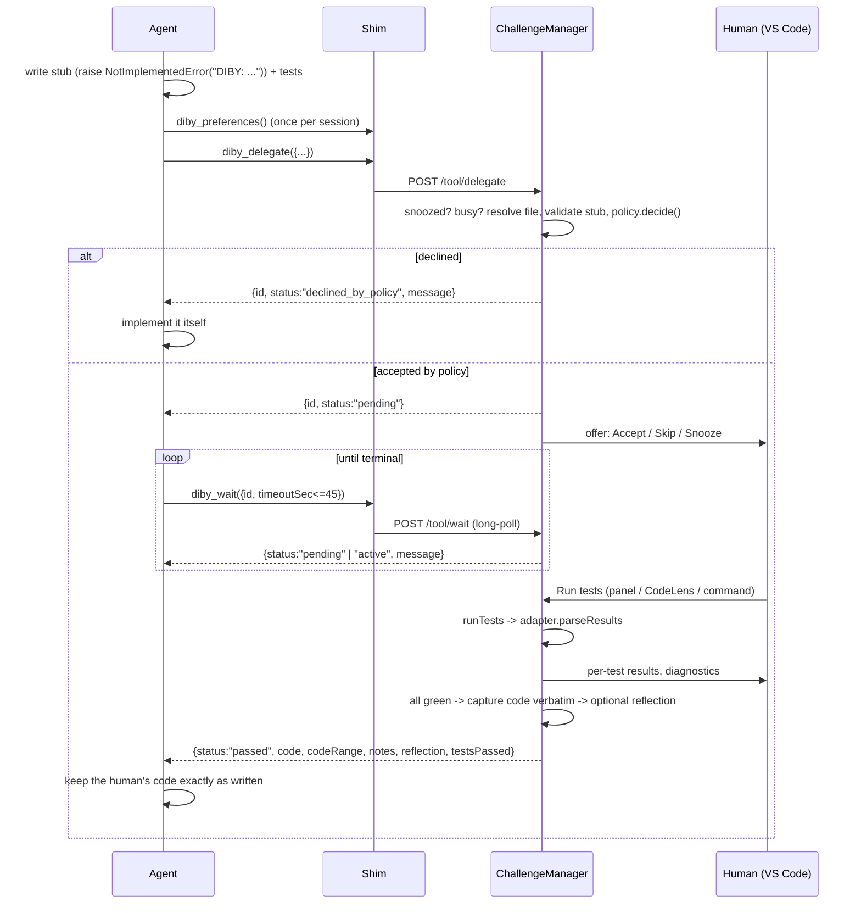

# Diby architecture

Diby ("Do it by yourself") is a VS Code extension that lets a coding agent hand a function back to the human as a practice exercise. The agent writes a stub plus tests and calls `diby_delegate`. The human implements the function and runs the tests in VS Code. The human's code goes back to the agent verbatim, and the agent builds on it without rewriting it.

The extension does not depend on any one agent. Claude Code, OpenAI Codex and GitHub Copilot agent mode all connect through the same stdio MCP shim, which forwards calls to an HTTP bridge inside the extension host.

---

## 1. Big picture

```mermaid
flowchart LR
  subgraph Agents
    CC[Claude Code]
    CX[Codex CLI]
    CP[Copilot agent mode]
  end
  subgraph Shim["dist/mcp-shim.js (plain node, stdio MCP)"]
    T[tools.ts<br/>diby_delegate / wait / cancel / preferences]
    L[locate.ts<br/>find endpoint file]
    C[client.ts<br/>POST /tool/:name]
  end
  EF[("~/.diby/endpoints/<br/>sha1(workspace).json")]
  subgraph Ext["VS Code extension host (dist/extension.js)"]
    B[bridge/server.ts<br/>127.0.0.1:random + bearer token]
    M[core/ChallengeManager<br/>implements ToolHandlers]
    P[core/policy.ts<br/>pure decide()]
    H[core/history.ts<br/>globalState]
    UI[ui/*<br/>panel, CodeLens, status bar, decorations]
    R[testing/runner.ts]
    LA[languages/*<br/>python, generic]
  end
  CC & CX & CP -- stdio MCP --> T
  T --> L --> EF
  T --> C -- HTTP JSON --> B --> M
  M --> P & H & UI & R
  R --> LA
  B -. writes .-> EF
```

ASCII version of the same picture:

```
 agent ──stdio MCP──> mcp-shim ──HTTP (Bearer)──> bridge ──> ChallengeManager ──> policy / history
                         │                          │                │
                         └── reads ~/.diby/endpoints/<sha1>.json <───┘ (written on activate)
                                                                     ├──> ChallengeUi (webview, CodeLens, status bar, decorations)
                                                                     └──> runTests ──> LanguageAdapter (python | generic)
```

### Core loop



### Status machine

```
delegate ─┬─> declined_by_policy                     (terminal, returned immediately)
          └─> pending ─┬─> declined                  (Skip / Snooze / offer ignored for 2 min)
                       ├─> cancelled                 (diby_cancel)
                       └─> active ─┬─> passed        (all tests green; code captured)
                                   ├─> gave_up       (Give up)
                                   └─> cancelled     (diby_cancel)
```

Only **one** challenge can be `pending` or `active` at a time. A `delegate` call while one is in progress returns `declined_by_policy` with reason "busy".

---

## 2. Module ownership

Each module belongs to exactly one implementer, who may only edit files in their own directories (and `test/` mirrors of them). Shared files are read-only for implementers.

| Module | Owner | Files (write access) | vscode import allowed in |
|---|---|---|---|
| **shared contract** | architect, then integrator | `src/types.ts`, `src/schemas.ts`, `src/constants.ts`, `src/globals.d.ts` | none |
| **integration** | INTEGRATOR | `src/extension.ts`, `src/config.ts`, `package.json`, build config, `README.md` | `extension.ts`, `config.ts` |
| **core-ui** | core-ui implementer | `src/core/**`, `src/ui/**`, `test/core/**`, `test/ui/**` | `src/ui/**` only |
| **transport** | transport implementer | `src/bridge/**`, `src/shim/**`, `test/bridge/**`, `test/shim/**` | none (pure Node) |
| **languages** | languages implementer | `src/testing/**`, `src/languages/**`, `test/testing/**`, `test/languages/**` | `src/languages/vscodeInterpreter.ts` only |
| **connect** | connect implementer | `src/connect/**`, `examples/**`, `test/connect/**` | `src/connect/command.ts`, `src/connect/copilot.ts` only |

Modules talk to each other **only** through `src/types.ts`, `src/schemas.ts` and `src/constants.ts`, and they are wired together only in `src/extension.ts`. No module imports another module's files. For example, `core` never imports `languages`, because it receives a `LanguageRegistry` and a `RunTestsFn` by injection. This is what lets the four implementers work in parallel.

If a shared type turns out to be wrong, **do not edit it**. Work around it locally and report the change you need to the integrator.

Every exported name listed in §3 already exists as a **placeholder** that throws `not implemented`, with its final signature in place. That means `npm run typecheck` and `npm run build` pass from the start. Replace the body and keep the signature.

---

## 3. CONTRACTS (exact exports per module)

Types (`Challenge`, `ToolHandlers`, `LanguageAdapter` and the rest) are defined in `src/types.ts`. Read the TSDoc there. It is normative.

### Shared (done, read-only)

| File | Exports |
|---|---|
| `src/types.ts` | `LineRange`, `Difficulty`, `DibyMode`, `ChallengeStatus`, `TerminalChallengeStatus`, `ToolName`, `DelegateRequest`, `DelegateResponse`, `WaitRequest`, `WaitResponse`, `CancelRequest`, `CancelResponse`, `PreferencesRequest`, `Preferences`, `ToolCallContext`, `ToolHandlers`, `BridgeErrorBody`, `EndpointInfo`, `BridgeServer`, `ResolvedFile`, `Challenge`, `OfferAnswer`, `PolicySettings`, `DibySettings`, `PolicyCandidate`, `PolicyDecision`, `PolicyFn`, `HistoryEntry`, `KeyValueStore`, `HistoryStore`, `TestCaseResult`, `TestDiagnostic`, `TestRunResult`, `RawTestOutput`, `InstrumentContext`, `InstrumentedCommand`, `StubValidation`, `LanguageAdapter`, `LanguageRegistry`, `RunTestsOptions`, `RunTestsFn`, `ChallengeUi`, `WorkspaceAccess`, `ChallengeManagerDeps`, `DisposableLike` |
| `src/schemas.ts` | `LineRangeSchema`, `DifficultySchema`, `DelegateRequestSchema`, `WaitRequestSchema`, `CancelRequestSchema`, `PreferencesRequestSchema`, `TOOL_INPUT_SCHEMAS: Record<ToolName, ZodType>`, `TOOL_DESCRIPTIONS: Record<ToolName, string>` |
| `src/constants.ts` | `DIBY_VERSION`, `BRIDGE_HOST`, `CWD_HEADER`, `DIBY_HOME_DIRNAME`, `ENDPOINTS_SUBDIR`, `SHIM_BIN_SUBDIR`, `SHIM_FILENAME`, `WAIT_DEFAULT_SEC`, `WAIT_MAX_SEC`, `SHIM_HTTP_TIMEOUT_MS`, `OFFER_TIMEOUT_MS`, `REFLECTION_TIMEOUT_MS`, `MAX_BODY_BYTES`, `MAX_OUTPUT_BYTES`, `MAX_HISTORY_ENTRIES`, `STUB_MARKER`, `MCP_SERVER_NAME`, `MCP_PROVIDER_ID`, `MCP_TOOL_NAMES`, `TOOL_NAMES`, `NOT_RUNNING_MESSAGE`, `AGENTS_MD_START`, `AGENTS_MD_END`, `CLAUDE_MD_IMPORT`, `CODEX_TOOL_TIMEOUT_SEC`, `CONTEXT_CHALLENGE_ACTIVE`, `COMMANDS`, `HISTORY_STATE_KEY` |
| `src/config.ts` (integrator) | `readSettings(): DibySettings`, `setMode(mode: DibyMode): Promise<void>`, `MODE_LABELS` |

### core-ui

| File | Export | Signature |
|---|---|---|
| `src/core/policy.ts` | `decide` | `PolicyFn` = `(candidate: PolicyCandidate, history: readonly HistoryEntry[], settings: PolicySettings, now: number) => PolicyDecision` (**pure**) |
| | `MODE_MIN_INTERVAL_MS` | `Record<'checkup'\|'steady'\|'learn', number>` |
| `src/core/history.ts` | `MementoHistoryStore` | `class implements HistoryStore { constructor(store: KeyValueStore, key = HISTORY_STATE_KEY, maxEntries = MAX_HISTORY_ENTRIES) }` |
| | `InMemoryHistoryStore` | `class implements HistoryStore { constructor(entries: HistoryEntry[] = []) }` |
| `src/core/ChallengeManager.ts` | `ChallengeManager` | `class implements ToolHandlers, DisposableLike { constructor(deps: ChallengeManagerDeps); delegate; wait; cancel; preferences; startDemo(req: DelegateRequest, ctx?: ToolCallContext): Promise<DelegateResponse>; runTests(id?: string): Promise<TestRunResult \| undefined>; giveUp(id?: string): Promise<void>; showPanel(id?: string): Promise<void>; snooze(): void; get snoozed(): boolean; current(): Challenge \| undefined; get(id: string): Challenge \| undefined; onDidChange(listener: (c: Challenge) => void): DisposableLike; dispose(): void }` (**no vscode import**) |
| `src/ui/challengeUi.ts` | `createChallengeUi` | `(context: vscode.ExtensionContext) => ChallengeUi & vscode.Disposable` |
| `src/ui/workspace.ts` | `createWorkspaceAccess` | `() => WorkspaceAccess` |
| `src/ui/ChallengePanel.ts`, `codelens.ts`, `statusBar.ts`, `decorations.ts` | internal to core-ui | free design. They are composed by `createChallengeUi`. |

### transport

| File | Export | Signature |
|---|---|---|
| `src/bridge/server.ts` | `startBridge` | `(handlers: ToolHandlers, opts?: StartBridgeOptions) => Promise<BridgeServer>` |
| | `StartBridgeOptions` | `{ port?: number; token?: string; log?: (m: string) => void }` |
| `src/bridge/endpointFile.ts` | `normalizeWorkspacePath` | `(p: string) => string` |
| | `workspaceKey` | `(p: string) => string` (sha1 hex of the normalized path) |
| | `endpointsDir` | `(home?: string) => string` |
| | `endpointFilePath` | `(workspace: string, home?: string) => string` |
| | `writeEndpointFile` | `(info: EndpointInfo, home?: string) => Promise<string>` |
| | `removeEndpointFile` | `(workspace: string, opts?: { home?: string; pid?: number }) => Promise<void>` |
| | `readEndpointFile` | `(filePath: string) => Promise<EndpointInfo \| undefined>` |
| | `listEndpoints` | `(home?: string) => Promise<EndpointInfo[]>` (newest first) |
| | `isPidAlive` | `(pid: number) => boolean` |
| `src/bridge/installShim.ts` | `installShim` | `(bundledShimPath: string, home?: string) => Promise<string>` (returns `~/.diby/bin/mcp-shim.js`) |
| `src/shim/locate.ts` | `locateEndpoint` | `(cwd: string, opts?: { home?: string; env?: NodeJS.ProcessEnv; isAlive?: (pid: number) => boolean }) => Promise<EndpointInfo \| undefined>` |
| `src/shim/client.ts` | `callBridge` | `(endpoint: EndpointInfo, tool: ToolName, args: unknown, opts: { cwd: string; timeoutMs?: number; signal?: AbortSignal }) => Promise<unknown>`. Throws `BridgeUnavailableError` (connection refused or reset) or `BridgeRequestError` (non-2xx, carries `BridgeErrorBody`). |
| `src/shim/tools.ts` | `registerDibyTools` | `(server: McpServer, deps: { cwd: string; locate: () => Promise<EndpointInfo \| undefined>; call: typeof callBridge }) => void` |
| `src/shim/main.ts` | (entry) | Creates `McpServer({name: 'diby', version: DIBY_VERSION})`, registers the tools and connects a `StdioServerTransport`. Has no exports. |

### languages

| File | Export | Signature |
|---|---|---|
| `src/testing/runner.ts` | `runTests` | `RunTestsFn` = `(opts: RunTestsOptions) => Promise<TestRunResult>`. Never rejects for process failures. |
| `src/testing/junit.ts` | `parseJUnitXml` | `(xml: string) => TestCaseResult[]` (throws on malformed XML) |
| | `summarizeCases` | `(cases: readonly TestCaseResult[]) => { passed; failed; errors; skipped; total }` |
| `src/languages/index.ts` | `createLanguageRegistry` | `(deps?: LanguageRegistryDeps) => LanguageRegistry` |
| | `LanguageRegistryDeps` | `{ python?: PythonAdapterDeps }` |
| `src/languages/generic.ts` | `createGenericAdapter` | `() => LanguageAdapter` (id `generic`) |
| `src/languages/python.ts` | `createPythonAdapter` | `(deps?: PythonAdapterDeps) => LanguageAdapter` (id `python`, aliases `['py', 'python3']`) |
| | `PythonAdapterDeps` | `{ resolveInterpreter?: (workspaceFolder: string) => Promise<string \| undefined> }` |
| `src/languages/vscodeInterpreter.ts` | `resolvePythonInterpreter` | `(workspaceFolder: string) => Promise<string \| undefined>` (vscode-facing) |

### connect

| File | Export | Signature |
|---|---|---|
| `src/connect/command.ts` | `registerConnectCommand` | `(context: vscode.ExtensionContext, deps: ConnectDeps) => vscode.Disposable` (registers `diby.connectAgents`) |
| | `ConnectDeps` | `{ getShimPath(): string; log(m: string): void }` |
| `src/connect/copilot.ts` | `registerCopilotMcpProvider` | `(context: vscode.ExtensionContext, bundledShimPath: string) => vscode.Disposable` |
| `src/connect/claudeCode.ts` | `mergeMcpJson` | `(existing: string \| undefined, shimPath: string) => string` (pure; throws on invalid JSON) |
| | `writeClaudeCodeConfig` | `(workspaceFolder: string, shimPath: string) => Promise<ConnectResult>` |
| `src/connect/codex.ts` | `mergeCodexToml` | `(existing: string \| undefined, shimPath: string) => string` (pure) |
| | `codexConfigPath` | `(home?: string) => string` (honours `$CODEX_HOME`, default `~/.codex/config.toml`) |
| | `writeCodexConfig` | `(shimPath: string, home?: string) => Promise<ConnectResult>` |
| `src/connect/agentsMd.ts` | `upsertAgentsSection` | `(existing: string \| undefined, snippet: string) => string` (pure, idempotent) |
| | `ensureClaudeImport` | `(existing: string \| undefined) => string` (pure, idempotent) |
| | `writeAgentInstructions` | `(workspaceFolder: string) => Promise<ConnectResult[]>` (AGENTS.md + CLAUDE.md) |
| `src/connect/snippet.ts` | `buildAgentsSnippet` | `() => string` (markdown **without** the markers) |
| `src/connect/types.ts` (optional) | `ConnectResult` | `{ target: 'claude-code' \| 'codex' \| 'copilot' \| 'agents-md' \| 'claude-md'; path?: string; changed: boolean; message: string }` |
| `examples/python-sample/` | n/a | see §4.4 |

---

## 4. Behaviour specs per module

### 4.1 core-ui

**ChallengeManager.delegate(req, ctx)** runs these checks in order. The first one that fails ends the call.
1. Snoozed → `declined_by_policy` with the message "Snoozed for this session".
2. A challenge is already `pending` or `active` → `declined_by_policy` with the message "busy".
3. `workspace.resolve(req.file, ctx.cwd)` fails → `declined_by_policy` with the message "file not found in an open workspace folder".
4. `languages.get(req.language).validateStub(text, req.range)` fails → `declined_by_policy`, and the message lists the problems.
5. `decide(candidate, history.all(), settings, now)`. Record a `HistoryEntry` for every non-demo call, with `offered = decision === 'accept'`. On decline, return `declined_by_policy` with `reason`.
6. Otherwise, create the challenge with status `pending`, return `{id, status: 'pending', message}` **immediately**, and run `ui.offer()` asynchronously:
   - `accept` → status `active`, set `acceptedAt`, call `ui.show()`.
   - `skip` → status `declined`.
   - `snooze` → call `snooze()`, then status `declined`.
   - If the challenge was cancelled while the offer was open, ignore the answer.

`testFiles` resolve against the same base as `file`. `testCwd` comes from `request.cwd` as described in the TSDoc.

**wait(req, ctx)** returns at once if the status is terminal. Otherwise it resolves on the next terminal transition, after `timeoutSec`, or when `ctx.signal` is aborted, whichever happens first. It always returns the current snapshot. An unknown id returns `{status: 'cancelled', message: 'Unknown challenge (VS Code may have restarted) — implement it yourself.'}`. `message` always says what to do next:

| status | message gist |
|---|---|
| pending | "Waiting for the human to accept. Call diby_wait again." |
| active | "Human is implementing `<symbol>` (n runs, x/y passing). Call diby_wait again; continue unrelated work meanwhile." |
| passed | "The human's implementation is already in `<file>` lines a–b and passes the tests. Do NOT rewrite, reformat or refactor it. Build on it as-is." |
| gave_up / declined / declined_by_policy / cancelled | "Implement `<symbol>` yourself (replace the stub)." |

**runTests(id?)** works as follows:
1. Refuse if `testsRunning` is already set.
2. Call `ui.saveFile`.
3. Call `deps.runTests({command, cwd: testCwd, workspaceFolder, adapter, timeoutSec: settings.testTimeoutSec})`.
4. Increment `attempts`, set `lastRun`, call `ui.refresh`.
5. If `ok`: call `ui.captureCode(ch, adapter)`. If `askForReflection` is on, call `ui.askReflection`. Then set status `passed` with `code`, `codeRange` (`range`), `notes` (for example "Passed 6/6 tests after 3 runs in 11m") and `reflection`, update history and call `ui.clear`. The panel stays open, showing success and any `referenceSolution`.

**giveUp(id?)** calls `ui.confirmGiveUp`, then captures the code as a best effort, sets status `gave_up`, and reveals `referenceSolution` in the panel.

**cancel(req)** applies only to a `pending` or `active` challenge: it sets status `cancelled`, calls `ui.clear`, and shows `ui.notify` with the reason. On a terminal challenge it does nothing.

**preferences()** returns the settings plus `snoozed`, `busy` and a `guidance` sentence, for example "Steady mode: about one challenge per hour; prefer difficulty 2–4 in parsing, regex."

**Policy** (`decide`) is **pure**. Concept comparison ignores case and treats spaces and underscores as `-`.
1. `mode === 'off'` → decline.
2. `difficulty > maxDifficulty` → decline.
3. Any concept appears in `avoidConcepts` → decline.
4. In `checkup` mode: `difficulty < 3` and no focus-concept match → decline.
5. Rate limit. Let `lastOffered` be the newest `createdAt` among entries where `offered === true`. Decline if `now - lastOffered < interval`. `interval` is `MODE_MIN_INTERVAL_MS[mode]` (checkup 24h, steady 60m, learn 2m), with two adjustments:
   - In `steady` mode, a focus-concept match halves the interval.
   - SHOULD: if the last 3 offered entries all ended `declined`, double the interval (back-off).
6. Otherwise accept. The `reason` explains the decision and, on a rate-limit decline, includes the time until the next allowed offer, for example "next in ~23m".

**History** is stored in `globalState` (per user, across workspaces) and trimmed to `maxEntries`, keeping the newest.

**UI** (`src/ui`, thin):
- **offer**: `showInformationMessage` with the buttons `Accept` / `Skip` / `Snooze for session`, raced against `OFFER_TIMEOUT_MS`. The text includes the symbol, concepts and difficulty.
- **show**: opens the file, reveals the range, adds a region decoration (background, border and overview ruler) and CodeLenses above the function ("▶ Run tests", "🏳 Give up", "Show challenge"), each passing `[challengeId]` to `diby.runTests` / `diby.giveUp` / `diby.showPanel`. It also adds a status bar item (symbol plus last pass count, clicking it shows the panel), sets the `diby.challengeActive` context key and opens the webview panel.
- **Region tracking**: shift `challenge.range` on `onDidChangeTextDocument`. In `captureCode`, prefer `adapter.locateSymbol(text, symbol, range)` and fall back to the tracked range. Return the text **verbatim**.
- **Diagnostics**: a `DiagnosticCollection('diby')` built from `lastRun.diagnostics`. Convert paths relative to `testCwd`.
- **Webview `ChallengePanel`**:
  - Strict CSP with a nonce, no remote resources, and styling from VS Code theme CSS variables.
  - Content: the spec rendered through the built-in `markdown.api.render` command (falling back to `<pre>`), the signature, the test command, test files as links, per-test pass/fail with expandable details, collapsible raw output, and the buttons Run Tests / Give Up.
  - Final states: a passed banner or a gave-up message, then the reference solution if there is one.
  - Messages are posted to the extension: `{type: 'runTests' | 'giveUp' | 'openFile', ...}`.
- **Idle status bar** (optional): `$(mortar-board) Diby: <mode>`. Clicking it runs `diby.setMode`.

### 4.2 transport

**Bridge** (`startBridge`):
- `http.createServer`, listening on `BRIDGE_HOST`, port 0 (random). The token is `crypto.randomBytes(32).toString('hex')`, compared with `timingSafeEqual`.
- Routes:
  - `POST /tool/<ToolName>`. Headers: `Authorization: Bearer <token>`, `Content-Type: application/json`, and optionally `X-Diby-Cwd: encodeURIComponent(cwd)`. The body is the tool arguments as JSON (`{}` if empty).
  - `GET /health` → `{ok: true, name: 'diby', version, pid}`. This route also requires the token.
- Validate the body with `TOOL_INPUT_SCHEMAS[name].safeParse`, then call `handlers[name](parsed, {cwd, signal})`. `signal` aborts when the response closes before it finishes.
- Responses: `200` with the result JSON. Errors use `BridgeErrorBody`: `400 invalid_request` (with zod `issues`), `401 unauthorized`, `404 not_found`, `413` (over `MAX_BODY_BYTES`, reported as `invalid_request`), `500 internal`.
- Long-polls: disable or raise the server `requestTimeout` so a 45 s `wait` is never cut off.

**Endpoint files**: there is one file per workspace folder at `~/.diby/endpoints/<sha1(normalizeWorkspacePath(folder))>.json`.
- The file holds `EndpointInfo` and is written atomically with mode `0600`.
- `removeEndpointFile` deletes it only if the file's `pid` matches. This way a second window cannot delete another window's file.
- `normalizeWorkspacePath` resolves the path, strips any trailing separator, and lowercases it on win32. Both sides MUST use it.
- `endpointsDir()` honours `$DIBY_ENDPOINT_DIR` when no explicit `home` is passed (both the writer and the shim read `process.env`). It exists for end-to-end tests (`test/e2e/bridge-shim.test.ts`) and unusual setups; normal users never set it.

**installShim** copies `dist/mcp-shim.js` to `~/.diby/bin/mcp-shim.js` when the content differs (write a temp file, then rename). Claude Code and Codex configs point at this **stable** path so that extension upgrades do not break them.

**locateEndpoint(cwd)** tries these sources in order:
1. `env.DIBY_ENDPOINT_FILE`.
2. `env.DIBY_WORKSPACE`.
3. Walk up from `cwd`, and from `fs.realpath(cwd)` (macOS `/tmp` → `/private/tmp`), and use the first directory whose endpoint file exists with a live `pid`.
4. Fall back to the newest live endpoint from `listEndpoints()`.
5. Otherwise return `undefined`.

**Shim**:
- Uses `McpServer` and `StdioServerTransport` from `@modelcontextprotocol/sdk` (`/server/mcp.js`, `/server/stdio.js`).
- Registers the four tools under `MCP_TOOL_NAMES`, with `inputSchema: TOOL_INPUT_SCHEMAS[name].shape` and `description: TOOL_DESCRIPTIONS[name]`. This combination was verified to bundle and list correctly with zod 4 and SDK 1.32.
- Re-locates the endpoint on **every** call, so it survives VS Code restarts.
- Clamps `wait.timeoutSec` to `WAIT_MAX_SEC`. The HTTP timeout is `SHIM_HTTP_TIMEOUT_MS`. The MCP request's abort signal is forwarded to the fetch.
- Success → `{content: [{type: 'text', text: JSON.stringify(result, null, 2)}]}`.
- No endpoint, or `BridgeUnavailableError` → `{isError: true, content: [{type: 'text', text: NOT_RUNNING_MESSAGE}]}`.
- `BridgeRequestError` → `isError` with the message.
- **Never write to stdout** except through the transport. Logs go to stderr.

### 4.3 languages

**runTests**:
1. Create a temp dir with `mkdtemp(os.tmpdir()/diby-run-)`.
2. Call `adapter.resolveInterpreter?.(workspaceFolder)`, then `adapter.instrumentTestCommand(command, tmpDir, {workspaceFolder, cwd, interpreter})`.
3. `spawn(cmd, {shell: true, cwd, env: {...process.env, NO_COLOR: '1', FORCE_COLOR: '0', ...opts.env, ...instr.env}, detached: process.platform !== 'win32'})`.
4. Kill the whole process group on timeout or abort.
5. Cap each stream at `MAX_OUTPUT_BYTES`.
6. Read `reportPath` if it exists, then call `adapter.parseResults(raw)`.
7. Always remove the temp dir.
8. Never reject for a failing process. A spawn error becomes `exitCode: null` plus a `stderr` note.

**Generic adapter**: `validateStub` always returns ok. Instrumentation is the identity. `ok = exitCode === 0 && !timedOut`. There are no cases and no diagnostics.

**Python adapter**:
- `validateStub`: the range must contain `raise NotImplementedError("DIBY…` (regex `/raise\s+NotImplementedError\(\s*[rRuU]?(['"]{1,3})DIBY/`) and a `def` line.
- `instrumentTestCommand`: if the command invokes pytest (`/\bpytest\b/`), add `--junitxml=<tmp>/report.xml -o junit_family=xunit1`. Recommended: pass these through `PYTEST_ADDOPTS` (appended to any existing value), which works with `uv run`, `python -m pytest`, `&&` chains and so on, instead of appending them to the command string. Skip this if the command already has `--junitxml`.
  - If an interpreter was resolved and the command starts with a bare `python`, `python3` or `pytest` token, rewrite that token to `"<interp>"` / `"<interp>" -m pytest`. Leave `uv`, `poetry` and similar launchers untouched.
- `parseResults`: parse the JUnit XML with `parseJUnitXml`. xunit1 gives `file` and `line` on `testcase`. Build diagnostics from failure tracebacks (lines like `path/to/x.py:12: AssertionError`), covering both the implementation file and the test files. If there is no report (for example, a collection error), fall back to generic plus the raw output.
- `locateSymbol`:
  - Find the `def` / `async def` for the last segment of `symbol` that is nearest to `hint`, and include any decorators above it.
  - Handle multi-line signatures: the body starts after the `:` at parenthesis depth 0.
  - The function ends at the last non-blank line before the next line whose indentation is less than or equal to the `def`'s indentation.
- `resolveInterpreter`: injected (`vscodeInterpreter.ts`). Use the `ms-python.python` extension API if it is installed (`extensions.getExtension('ms-python.python')`, then `exports.environments.getActiveEnvironmentPath` / `resolveEnvironment`; never a hard dependency). Otherwise use the `python.defaultInterpreterPath` setting. Otherwise return `undefined`, and the adapter assumes `python3` is on PATH.

**Future adapters** (C++/CMake + doctest sandbox, C, Java/Surefire XML, TS/JS vitest/jest junit) fit the current interface:
- build steps go into `cmd`,
- sandbox files go into `tmpDir`,
- compiler errors go into `diagnostics`,
- `parseJUnitXml` is reused.

Do not implement them now.

### 4.4 connect

**`diby.connectAgents`**:
1. If there are several workspace folders, pick one.
2. Show a multi-select QuickPick with every option picked by default: *Claude Code (.mcp.json)*, *Codex (~/.codex/config.toml)*, *Agent instructions (AGENTS.md + CLAUDE.md)*, plus an info row: *Copilot: automatic*.
3. Codex needs a **modal** confirmation before the global file is touched.
4. Finish with a summary notification that offers to open the changed files.

**Claude Code**: merge `{"mcpServers": {"diby": {"command": "node", "args": ["<stable shim>"]}}}` into `<folder>/.mcp.json`. Keep the other servers and keys. Use 2-space JSON with a trailing newline. If the existing file is invalid JSON, throw rather than overwrite.

**Codex**: write `[mcp_servers.diby]` with `command = "node"`, `args = ["<stable shim>"]` and `tool_timeout_sec = 60`.
- Do not round-trip the whole file through `smol-toml`, because that would lose the user's comments. Replace the existing `[mcp_servers.diby]` table text, or append a new block.
- Generate that block with `smol-toml` `stringify`, and validate the final file with `parse`.

**Copilot**: call `vscode.lm.registerMcpServerDefinitionProvider(MCP_PROVIDER_ID, {provideMcpServerDefinitions})`, returning `new McpStdioServerDefinition('Diby', process.execPath, [bundledShimPath], {ELECTRON_RUN_AS_NODE: '1', DIBY_WORKSPACE: <first folder fsPath>}, DIBY_VERSION)`, with `cwd` set to the first folder Uri.
- Guard with `typeof vscode.lm?.registerMcpServerDefinitionProvider === 'function'`. If it is missing, return a no-op Disposable.
- Fire `onDidChangeMcpServerDefinitions` when the workspace folders change.

**AGENTS.md / CLAUDE.md**:
- `upsertAgentsSection` replaces the text between `AGENTS_MD_START` and `AGENTS_MD_END`, or appends the markers plus the snippet, keeping a blank line before it.
- `ensureClaudeImport` adds a `@AGENTS.md` line if no line already equals it after trimming. A missing file becomes `"@AGENTS.md\n"`.
- Both functions are idempotent: running them twice produces no diff.

**Snippet**: the content of `buildAgentsSnippet()`. It tells agents to:
- call `diby_preferences` once per session;
- delegate only self-contained 5–40 line functions with educational value (parsing, algorithms, transforms, validation), never glue or boilerplate, and only ones that match the preferences;
- write the stub first (Python: `raise NotImplementedError("DIBY: <symbol>")`) plus focused tests and a narrow `testCommand`, then call `diby_delegate`;
- keep polling `diby_wait` while the status is pending or active, doing unrelated work in between;
- treat `declined`, `declined_by_policy`, `gave_up` and `cancelled` as "write it yourself";
- leave the human's code exactly as written after `passed`. It is already in the file. Do not rewrite or reformat it.

The snippet includes a short worked example and a note that Diby only works while VS Code is open.

**examples/python-sample/**: a small realistic `textkit` package.
- `pyproject.toml` with `requires-python >= 3.9` and `[tool.pytest.ini_options]` setting `testpaths = ["tests"]` and `pythonpath = ["."]`.
- A couple of implemented functions with their tests.
- One delegated stub, for example `textkit/duration.py::parse_duration("1h30m") -> 5400`, with `tests/test_duration.py`.
- `.diby/demo-challenge.json`: a valid `DelegateRequest` with paths relative to `examples/python-sample/` and `testCommand: "uv run --with pytest pytest -q tests/test_duration.py"`. The `diby.startDemoChallenge` command passes `cwd` = the folder above `.diby/`.
- A short `README.md`.

To run the sample's tests locally: `cd examples/python-sample && uv run --with pytest pytest -q`. The stub's tests are expected to fail.

---

## 5. Conventions

- **TypeScript strict** with `noUncheckedIndexedAccess`. No `any` except at JSON boundaries, which are parsed with zod or narrowed explicitly.
- **Pure modules do not import `vscode`.** Only these files may: `src/extension.ts`, `src/config.ts`, `src/ui/**`, `src/languages/vscodeInterpreter.ts`, `src/connect/command.ts`, `src/connect/copilot.ts`. Everything else must run under vitest in plain Node. A vitest import of `vscode` fails, by design.
- **VS Code-facing code is thin.** Logic goes in pure functions that get unit tests. The vscode files only adapt.
- **Lines are 1-based and inclusive** everywhere outside `src/ui`.
- **Paths**: absolute inside the extension. Agents may send relative paths, which are resolved once in `WorkspaceAccess.resolve`.
- **No new runtime dependencies** without asking the integrator. The ones available are `@modelcontextprotocol/sdk`, `zod` (v4), `fast-xml-parser` (v5) and `smol-toml`, plus Node built-ins.
- **Tests**: `test/<same path as src>.test.ts`, run with vitest. Use temp dirs (`fs.mkdtemp`) and the `home` parameters, and never touch the real `~/.diby`, `~/.codex` or the repo. Python integration tests may shell out to `uv run --with pytest pytest`. Skip them with `it.skipIf` when `uv` is missing.
- **Logging**: in the extension, the injected `log`, which writes to the "Diby" output channel. In the shim, stderr only.
- **Security**: the bridge binds to loopback only, uses a bearer token, and endpoint files are mode `0600`. Test commands run only on an explicit user action (Run Tests). The extension declares `untrustedWorkspaces: false`.
- **Never modify `docs/ai-logs/`.**

## 6. Commands, settings, build

- **Commands**: `diby.connectAgents`, `diby.runTests [id]`, `diby.giveUp [id]`, `diby.showPanel [id]`, `diby.snooze`, `diby.setMode`, `diby.startDemoChallenge [uri]`.
- **Settings**: `diby.mode` (off, checkup, steady (default), learn), `diby.focusConcepts`, `diby.avoidConcepts`, `diby.maxDifficulty` (1–5, default 5), `diby.testTimeoutSec` (default 60), `diby.askForReflection` (default true).
- **Context key**: `diby.challengeActive`.
- **Build**: `npm run build` produces `dist/extension.js` and `dist/mcp-shim.js` (esbuild, cjs). Other scripts: `npm run watch`, `npm run typecheck`, `npm test`, `npm run check` (typecheck, build, then test, so the e2e test in `test/e2e/` runs against the built shim), `npm run package` (`.vsix`). Press **F5** ("Run Diby Extension") to open an Extension Development Host on `examples/python-sample`.

## 7. Open items for the integrator

- Write `README.md` for the public repo: hero/tagline, GIF placeholder, how it works, a supported-agents table, install, Connect Agents, modes, writing adapters, contributing and license. It is **not** owned by any implementer.
- ~~Add a `media/icon.png` and an `icon` field in package.json, plus `CHANGELOG.md`.~~ Done (`media/icon.png` is rendered from `media/icon.svg`).
- ~~First-run notification that suggests "Diby: Connect Agents".~~ Done (`maybeSuggestConnect` in `src/extension.ts`, shown once per machine).
