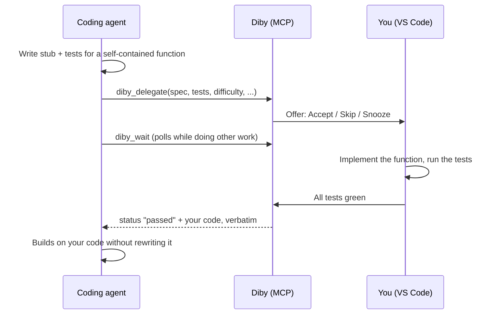

<div align="center">

<picture>
  <source media="(prefers-color-scheme: dark)" srcset="media/logo-wordmark-dark.svg">
  
</picture>

**Do it by yourself — your coding agent hands you the interesting bits.**

[](https://github.com/SeamusMullan/diby/actions/workflows/ci.yml)
[](LICENSE)
[](https://code.visualstudio.com/)


</div>

---

## Why Diby

AI agents now write more and more of our code, and the skills we stop using start to fade. Diby is a VS Code extension that interleaves deliberate practice into real work: when your agent hits a self-contained function with educational value, it can hand that function to you with a spec and tests, then build the rest of the task around your solution.

You stay in the loop on the parts worth thinking about. The agent keeps doing the glue.

> **Early preview.** The core loop works and is covered by automated tests, but it has not yet been exercised inside a real VS Code window. Expect rough edges. See the [roadmap](#roadmap).

## How it works



If you skip, snooze, give up, or Diby is not running, the agent simply implements the function itself.

## Features

- **Agent-agnostic.** One stdio MCP shim serves Claude Code, Codex and GitHub Copilot agent mode.
- **Challenge panel** with the agent's spec rendered as markdown, per-test results, and Run Tests / Give Up controls.
- **CodeLens, status bar and decorations** right on the stubbed function.
- **Frequency control.** Choose how often you get offers, or turn Diby off.
- **Preferences for agents.** Focus concepts, avoided concepts and a maximum difficulty are passed to the agent.
- **Your code goes back verbatim.** The agent is instructed not to rewrite, reformat or "improve" it.
- **Optional reflection.** After you pass, leave a one-line note that is sent to the agent.
- **One-command setup.** `Diby: Connect Agents` writes the config for you.
- **Safe by design.** The bridge listens on `127.0.0.1` with a bearer token. Diby requires a trusted workspace because it runs test commands supplied by the agent.

## Frequency modes

Set with `diby.mode` or the **Diby: Set Mode** command.

| Mode | Behaviour |
| --- | --- |
| `off` | Never offer challenges. Agents always write the code themselves. |
| `checkup` | Rare check-ups: at most one challenge per 24 hours, preferring harder (difficulty 3+) functions. |
| `steady` (default) | A steady trickle: roughly one challenge per hour. |
| `learn` | Learning mode: accept most suitable functions the agent offers. |

## Supported agents

| Agent | How it connects | Status |
| --- | --- | --- |
| Claude Code | `Connect Agents` merges a `diby` server into `<workspace>/.mcp.json` | ✅ Implemented, untested in a live editor |
| Codex CLI | `Connect Agents` writes `[mcp_servers.diby]` to `~/.codex/config.toml` (asks first; comments preserved) | ✅ Implemented, untested in a live editor |
| GitHub Copilot (agent mode) | Registered automatically through VS Code's MCP server definition provider | ✅ Implemented, untested in a live editor |

`Connect Agents` also adds a Diby section to `AGENTS.md` and an `@AGENTS.md` import to `CLAUDE.md`, teaching agents when and how to delegate. It is idempotent.

## Language support

| Language | Status |
| --- | --- |
| Python | ✅ Supported (pytest) |
| Any language with a test command | ✅ Via the generic adapter (exit code based, stub must contain `DIBY`) |
| C++ | 🛠 Next |
| C | 🗓 Planned |
| Java | 🗓 Planned |
| TypeScript / JavaScript | 🗓 Planned |

## Quick start

Diby is not on the Marketplace yet, so install from source.

```sh
git clone https://github.com/SeamusMullan/diby.git
cd diby
npm install
npm run build
```

1. Open the folder in VS Code and press **F5** to launch an Extension Development Host.
2. In the host window, open your project and run **Diby: Connect Agents** from the command palette. Pick the agents you use.
3. Ask your agent for something with a self-contained helper, for example "add a `--timeout 1h30m` flag to the CLI". If the frequency policy says yes, you get an offer.

No agent handy? Try the bundled sample. Open `examples/python-sample`, run **Diby: Start Demo Challenge**, and implement `parse_duration`. See the [sample README](examples/python-sample/README.md). The demo's test command uses [`uv`](https://docs.astral.sh/uv/).

Diby only works while VS Code is open with the extension running.

## Configuration

| Setting | Default | Description |
| --- | --- | --- |
| `diby.mode` | `steady` | `off`, `checkup`, `steady` or `learn`. How often agents may hand you functions. |
| `diby.focusConcepts` | `[]` | Concepts you want to practise (e.g. `recursion`, `parsing`). Preferred when choosing challenges. |
| `diby.avoidConcepts` | `[]` | Concepts you never want to be handed. |
| `diby.maxDifficulty` | `5` | Highest difficulty (1-5) Diby will accept. |
| `diby.testTimeoutSec` | `60` | Seconds before a test run is killed (5-600). |
| `diby.askForReflection` | `true` | Ask for an optional one-line reflection after you pass. |
| `diby.python.disablePluginAutoload` | `false` | Set `PYTEST_DISABLE_PLUGIN_AUTOLOAD=1` for Python challenges. Enable it if unrelated packages on `PYTHONPATH` (for example a sourced ROS environment) register broken pytest plugins. |

Other commands: **Run Tests**, **Give Up**, **Show Challenge**, **Snooze for This Session**.

## MCP tools

Exposed to agents by `dist/mcp-shim.js`:

| Tool | Purpose |
| --- | --- |
| `diby_delegate` | Offer a stubbed function (spec, tests, test command, concepts, difficulty) to the human. |
| `diby_wait` | Long-poll for the challenge status; returns the human's code once it has passed. |
| `diby_cancel` | Withdraw an open challenge. |
| `diby_preferences` | Read the user's mode, focus/avoid concepts and maximum difficulty. |

## Architecture

The agent talks stdio MCP to a small Node shim, which forwards calls over a token-protected localhost HTTP bridge to the extension host. There, a challenge manager applies the frequency policy, drives the UI and runs tests through language adapters. Details, contracts and module ownership are in [ARCHITECTURE.md](ARCHITECTURE.md).

```
agent --stdio MCP--> mcp-shim --HTTP (Bearer)--> bridge --> ChallengeManager --> policy / UI / test runner
```

## Roadmap

- [x] **M0** Architecture and contracts
- [x] **M1** Core loop: MCP shim, bridge, challenge panel, Python adapter, Connect Agents, demo sample
- [ ] Verify end to end in a real VS Code window with each agent
- [ ] Policy refinements and a guard against agents editing a challenge in flight
- [ ] Hints and code review through `vscode.lm`
- [ ] C++ adapter
- [ ] C adapter
- [ ] Progress and stats
- [ ] Java adapter
- [ ] TypeScript / JavaScript adapters
- [ ] VS Code Marketplace and Open VSX publishing

Known gaps today: endpoint liveness is a pid check only (no health probe), the spec panel uses a simplified markdown renderer without links or images, and the offer timeout lives only in the UI.

## Contributing

Contributions are welcome. Please read [CONTRIBUTING.md](CONTRIBUTING.md) and the [Code of Conduct](CODE_OF_CONDUCT.md) first.

```sh
npm run check   # typecheck, build, test
```

## License

[MIT](LICENSE) © Seamus Mullan
