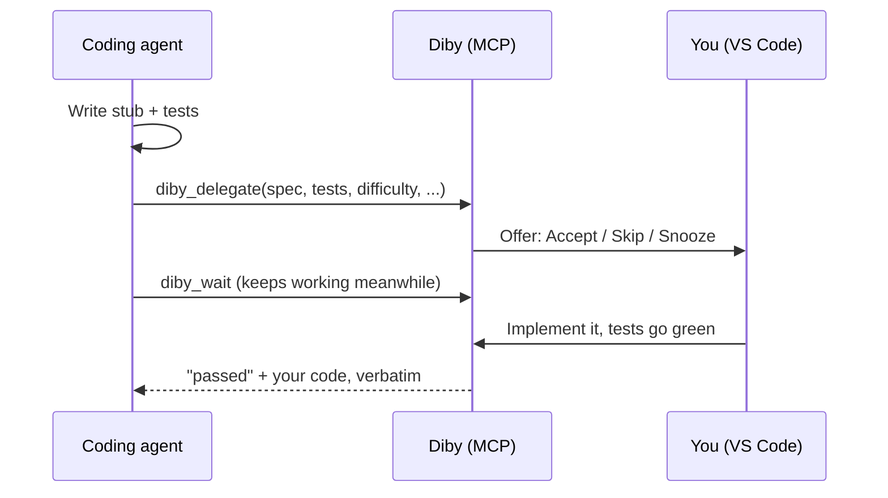

<div align="center">

<picture>
  <source media="(prefers-color-scheme: dark)" srcset="media/logo-wordmark-dark.png">
  
</picture>

**Do it by yourself — your coding agent hands you the interesting bits.**

[](https://github.com/SeamusMullan/diby/actions/workflows/ci.yml)
[](LICENSE)
[](https://code.visualstudio.com/)


</div>

---

## Why Diby

Agents write more and more of our code, and the skills we stop using fade. When your agent reaches a self-contained function worth practising, Diby lets it hand that function to you with a spec and tests, then build the rest of the task around your code.

> **Early preview.** Used day to day with Claude Code; Codex and Copilot are untested in a live editor. See the [roadmap](ROADMAP.md).

## How it works



If you skip, give up, or Diby isn't running, the agent writes the function itself.

## Features

- **Works with Claude Code, Codex and GitHub Copilot** through one MCP server. `Diby: Connect Agents` sets it up.
- **Challenge panel** with the spec, per-test results and Run Tests / Give Up.
- **Offers you won't miss:** a modal, an editor tab or a notification, plus a status bar reminder.
- **Stays out of your way:** frequency modes, quiet hours, snooze, and inline suggestions turned off while you work.
- **Progress:** pass rate, daily streak and concepts that need practice (**Diby: Show Stats**).
- **Your code goes back verbatim;** agents are told not to rewrite it.
- **Local and token-protected:** the bridge only listens on `127.0.0.1`. Requires a trusted workspace, since it runs agent-supplied test commands.

**Languages:** Python (pytest) and TypeScript / JavaScript (vitest) with per-test results; anything else through its exit code. More are on the [roadmap](ROADMAP.md).

## Quick start

1. Install the `.vsix` from the [latest release](https://github.com/SeamusMullan/diby/releases/latest): `code --install-extension diby-<version>.vsix`.
2. In your project, run **Diby: Connect Agents** and pick your agents.
3. Ask your agent for something with a self-contained helper, e.g. "add a `--timeout 1h30m` flag to the CLI".

No agent handy? Open `examples/python-sample` and run **Diby: Start Demo Challenge** ([details](examples/python-sample/README.md)).

## Configuration

| Setting | Default | Description |
| --- | --- | --- |
| `diby.mode` | `steady` | `off`, `checkup` (one a day, difficulty 3+), `steady` (about one an hour) or `learn` (most offers). |
| `diby.offerStyle` | `modal` | `modal`, `panel` (editor tab with the full spec) or `notification`. Offers expire after 2 minutes. |
| `diby.quietHours` | `""` | Local-time window with no offers, e.g. `22:00-07:30`. |
| `diby.focusConcepts` / `diby.avoidConcepts` | `[]` | Concepts to prefer or never be handed. |
| `diby.maxDifficulty` | `5` | Highest difficulty (1-5) to accept. |
| `diby.disableInlineSuggestions` | `true` | Turn off inline suggestions during a challenge. |
| `diby.askForReflection` | `true` | Ask for a one-line note after you pass. |
| `diby.testTimeoutSec` | `60` | Kill test runs after this many seconds. |
| `diby.python.disablePluginAutoload` | `false` | Set `PYTEST_DISABLE_PLUGIN_AUTOLOAD=1`, for broken third-party pytest plugins. |

## For agents

Diby exposes four MCP tools: `diby_preferences`, `diby_delegate`, `diby_wait` and `diby_cancel`. `Connect Agents` writes the MCP config (`.mcp.json`, `~/.codex/config.toml`, or Copilot's provider) and an `AGENTS.md` section explaining when and how to delegate. The design is in [ARCHITECTURE.md](ARCHITECTURE.md).

## Contributing

Contributions are welcome. Read [CONTRIBUTING.md](CONTRIBUTING.md) and the [Code of Conduct](CODE_OF_CONDUCT.md) first.

```sh
npm install
npm run check   # typecheck, build, test
```

Press **F5** in VS Code to launch an Extension Development Host.

## License

[MIT](LICENSE) © Seamus Mullan
