# Roadmap

The plan from v0.0.5 to v0.1.0. Versions ship in order; within a version, items are roughly in priority order. 🎯 marks features with a function that makes a good Diby challenge, so we keep dogfooding as we build.

```mermaid
gantt
  title Diby to v0.1.0 (order only, not dates)
  dateFormat X
  axisFormat %s
  todayMarker off

  section v0.0.5 Challenge experience
  Hint ladder                 :a1, 0, 2s
  Compile errors in panel     :a2, after a1, 2s
  Run on save + keybinding    :a3, after a2, 1s
  Elapsed timer               :a4, after a3, 1s
  TypeScript locateSymbol     :a5, after a4, 2s
  Better spec markdown        :a6, after a5, 2s
  Offer timeout in manager    :a7, after a6, 1s

  section v0.0.6 Agent integration
  In-flight edit guard        :b1, after a7, 3s
  Richer preferences          :b2, after b1, 1s
  Snooze durations            :b3, after b2, 2s
  Auto-snooze while debugging :b4, after b3, 1s
  Endpoint health probe       :b5, after b4, 1s

  section v0.0.7 Languages
  Jest + node --test          :c1, after b5, 2s
  Go                          :c2, after c1, 2s
  Rust                        :c3, after c2, 2s
  C++ and C                   :c4, after c3, 3s
  Java                        :c5, after c4, 2s

  section v0.0.8 History and progress
  History view                :d1, after c5, 2s
  Retry a past challenge      :d2, after d1, 2s
  Spaced repetition           :d3, after d2, 2s
  Difficulty calibration      :d4, after d3, 1s
  Daily goal + export         :d5, after d4, 1s

  section v0.0.9 Learning aids
  Compare with reference      :e1, after d5, 2s
  Hints and review via vscode.lm :e2, after e1, 3s
  Reflection journal          :e3, after e2, 1s

  section v0.1.0 Release readiness
  E2E tests in CI             :f1, after e3, 3s
  Verify every agent          :f2, after f1, 2s
  Getting-started walkthrough :f3, after f2, 1s
  Marketplace + Open VSX      :milestone, f4, after f3, 0s
```

## Shipped

- **v0.0.1** Core loop: MCP shim, bridge, challenge panel, Python adapter, Connect Agents, demo sample.
- **v0.0.2** Offer styles (modal, panel, notification) with a status bar reminder; Show Stats and streaks.
- **v0.0.3** TypeScript / JavaScript adapter (vitest) with per-test results; Needs practice stats.
- **v0.0.4** Quiet hours; inline suggestions turned off during challenges.

## v0.0.5: Challenge experience

Better feedback while you work. Both give-ups during testing came down to feedback.

- [ ] **Hint ladder.** Agents pass `hints: string[]` with `diby_delegate`; the panel reveals them one at a time. Hints used are recorded and reported back.
- [ ] **Compile errors in the panel.** Show `tsc` and Python syntax errors as their own banner with file and line, not just a failed run.
- [ ] **Run tests on save** (`diby.runTestsOnSave`) and a keybinding for Run Tests.
- [ ] **Elapsed timer** in the panel and status bar, with an optional time limit.
- [ ] **TypeScript `locateSymbol`** so the function is re-found after edits, as in Python. 🎯 brace-matching function extent
- [ ] **Better spec markdown:** tables, links, nested lists (or VS Code's built-in renderer).
- [ ] **Offer timeout in the manager** instead of only the UI.

## v0.0.6: Agent integration

- [ ] **Guard against agents editing a challenge in flight:** warn or revert edits to the region or its tests from anyone but you.
- [ ] **Richer `diby_preferences`:** `recentConcepts` so agents vary what they offer, and `suggestedFocus` from Needs practice.
- [ ] **Snooze durations:** "30m", "until 17:00", "until tomorrow". 🎯 `parseSnooze`
- [ ] **Auto-snooze while debugging** (`vscode.debug.activeDebugSession`).
- [ ] **Endpoint health probe** instead of a pid-only liveness check.

## v0.0.7: Languages

- [ ] **Jest** (`--json --outputFile`) and **`node --test`** (`--test-reporter=junit`). 🎯 jest JSON to test cases
- [ ] **Go** via `go test -json`. 🎯 event stream to test cases
- [ ] **Rust** (`cargo test`).
- [ ] **C++** (CMake + doctest / ctest) and **C**.
- [ ] **Java** (Surefire XML through the existing JUnit parser).

## v0.0.8: History and progress

- [ ] **History view:** a sidebar tree of past challenges with status, time and your code.
- [ ] **Retry a past challenge** locally, replayed like the demo challenge, no agent needed.
- [ ] **Spaced repetition:** suggest retries of given-up challenges at growing intervals. 🎯 SM-2-style scheduler
- [ ] **Difficulty calibration:** suggest `maxDifficulty` from your pass rate per level. 🎯
- [ ] **Daily goal** with a gentle streak reminder, and **stats export** (JSON / CSV).

## v0.0.9: Learning aids

- [ ] **Compare with reference:** after giving up, diff your attempt against the reference solution.
- [ ] **Hints and review through `vscode.lm`** (optional): a nudge that doesn't give the answer away, and a short review after passing.
- [ ] **Reflection journal:** your post-challenge notes in one searchable view.

## v0.1.0: Release readiness

- [ ] **End-to-end tests in CI** with `@vscode/test-electron` and a fake agent: offer, accept, write, pass.
- [ ] **Verify every agent** (Claude Code, Codex, Copilot) and document quirks.
- [ ] **Getting-started walkthrough** replacing the one-time notification.
- [ ] **Marketplace and Open VSX publishing** from the release workflow, with screenshots and a demo GIF.
